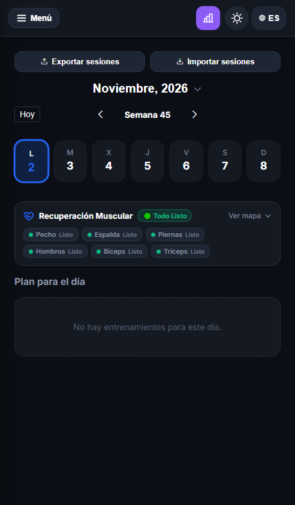
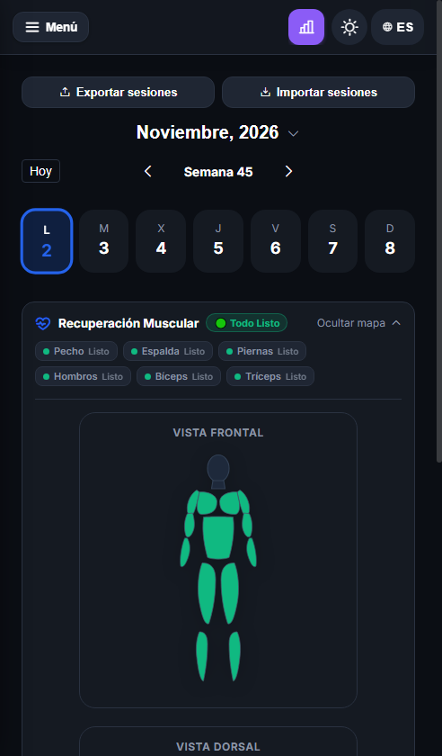
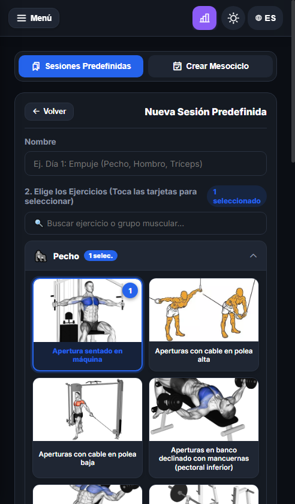
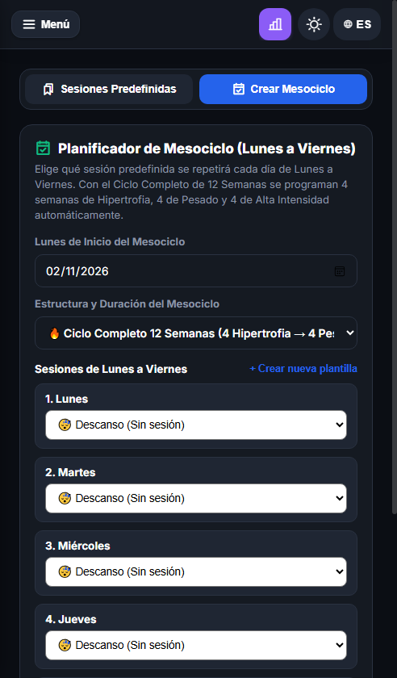
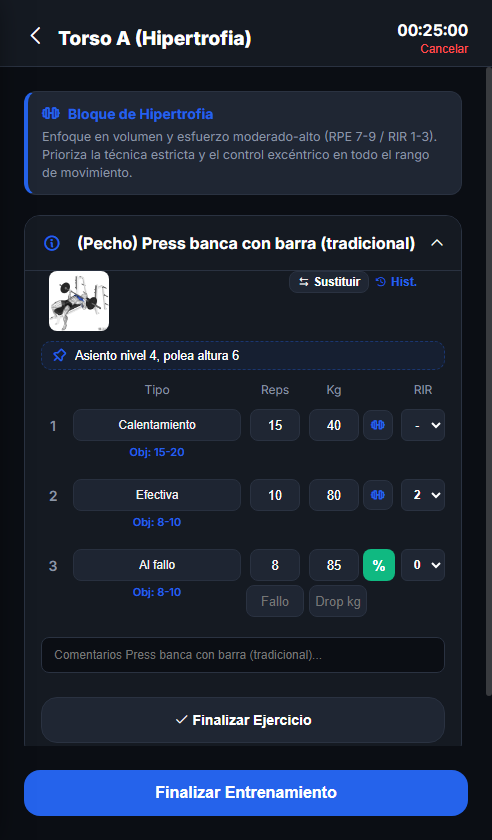
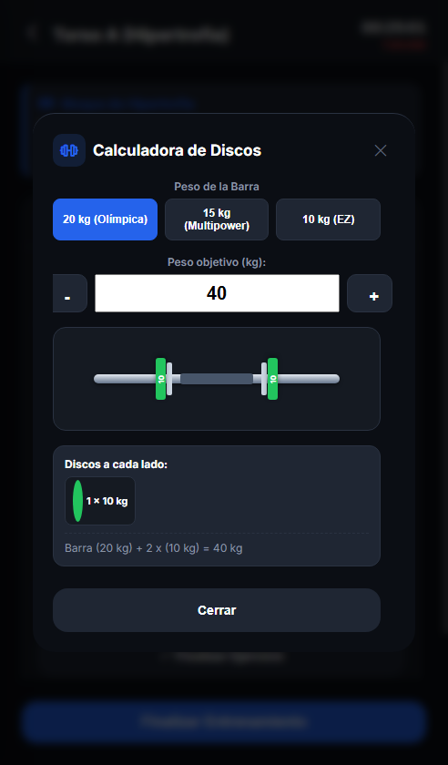
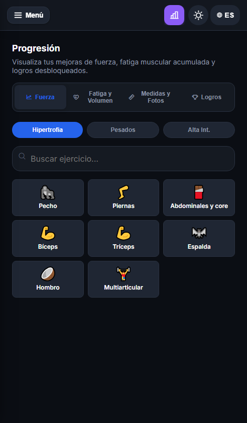
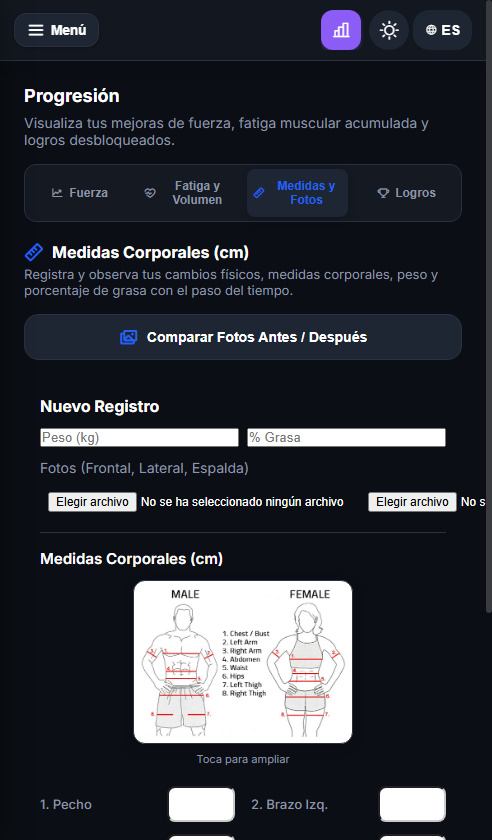
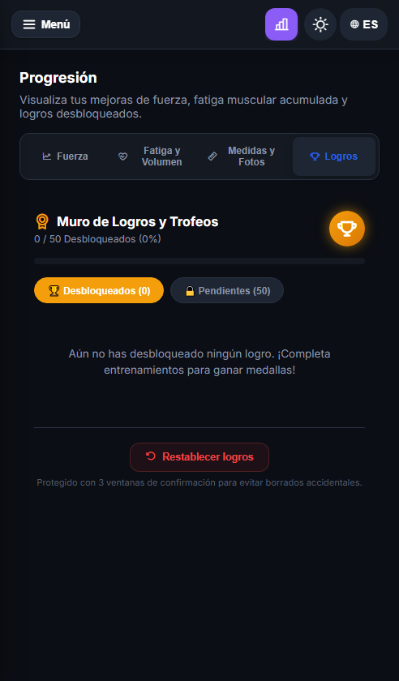

# 🏋️‍♂️ Gym Tracker — Tu Cuaderno de Entrenamiento Definitivo

<div align="center">


<p align="center">
  <b>Gym Tracker</b> es una aplicación de registro y periodización de fuerza diseñada para culturistas, atletas de fuerza y entusiastas del fitness que buscan precisión absoluta en sus entrenamientos, sobrecarga progresiva científica y privacidad total sin depender de internet ni muros de pago.
</p>

</div>

---

## 📑 Tabla de Contenidos
1. [🌟 Filosofía y Características Principales](#-filosofía-y-características-principales)
2. [🧭 Desglose Completo de Menús y Funciones](#-desglose-completo-de-menús-y-funciones)
   - [📅 1. Menú Calendario & Recuperación](#-1-menú-calendario--recuperación)
   - [🗂️ 2. Creador de Sesiones & Mesociclos](#-2-creador-de-sesiones--mesociclos)
   - [⏱️ 3. Menú En Curso (Entrenamiento Activo)](#️-3-menú-en-curso-entrenamiento-activo)
   - [🏋️ 4. Menú Ejercicios (Biblioteca de Movimientos)](#️-4-menú-ejercicios-biblioteca-de-movimientos)
   - [🕒 5. Menú Historial Global](#-5-menú-historial-global)
   - [📊 6. Menú Estadísticas Unificadas](#-6-menú-estadísticas-unificadas)
   - [💾 7. Menú Exportar / Importar](#-7-menú-exportar--importar)
   - [🤖 8. Asistente IA (Carlo)](#-8-asistente-ia-carlo)
3. [📚 Tutoriales Paso a Paso](#-tutoriales-paso-a-paso)
   - [Tutorial 1: Cómo programar un mesociclo de 12 semanas](#tutorial-1-cómo-programar-un-mesociclo-de-12-semanas)
   - [Tutorial 2: Cómo entrenar en vivo aplicando Sobrecarga Progresiva, Notas y RIR](#tutorial-2-cómo-entrenar-en-vivo-aplicando-sobrecarga-progresiva-notas-y-rir)
   - [Tutorial 3: Cómo gestionar la recuperación muscular y evitar el sobreentrenamiento](#tutorial-3-cómo-gestionar-la-recuperación-muscular-y-evitar-el-sobreentrenamiento)
   - [Tutorial 4: Cómo registrar medidas corporales y comparar fotos de evolución](#tutorial-4-cómo-registrar-medidas-corporales-y-comparar-fotos-de-evolución)
   - [Tutorial 5: Cómo hacer copias de seguridad e importar desde Excel](#tutorial-5-cómo-hacer-copias-de-seguridad-e-importar-desde-excel)
4. [🛠️ Herramientas Auxiliares Integradas](#️-herramientas-auxiliares-integradas)
5. [📥 Instalación y Actualización](#-instalación-y-actualización)

---

## 🌟 Filosofía y Características Principales

Gym Tracker nace de la frustración con las aplicaciones comerciales de gimnasio repletas de publicidad invasiva, suscripciones abusivas mensuales, sincronizaciones lentas en la nube y menús sobrecargados.

- **🔒 100% Offline & Privado**: Todos tus datos, notas personales, marcas y fotos corporales se almacenan de forma local y segura en tu propio dispositivo. Ningún servidor externo tiene acceso a tu información.
- **📈 Sobrecarga Progresiva Automatizada**: El sistema analiza tus series de sesiones previas y te sugiere automáticamente el aumento exacto de peso (+2.5 kg en ejercicios básicos de barra, +1 kg en mancuernas o aislamiento) o de repeticiones (+1 rep) cuando alcanzas el límite superior de tu rango objetivo.
- **🔄 Periodización por Mesociclos**: Soporte nativo para 3 fases clave de entrenamiento: **Hipertrofia**, **Pesados (Fuerza)** y **Alta Intensidad**, con series, repeticiones y descansos configurables individualmente por ejercicio y tipo de fase.
- **🫀 Monitorización de Fatiga y Recuperación**: Estimación fisiológica de recuperación basada en el tiempo transcurrido desde tu último estímulo y en el volumen de series efectivas acumuladas en la semana.
- **⚡ Fluidez y Cero Fricción**: Modales optimizados, autorrellenado de series en 1 toque con marcas fantasma (*Ghost Workout*), calculadoras de discos integradas y atajos rápidos.

---

## 🧭 Desglose Completo de Menús y Funciones

```
Gym Tracker
├── 📅 Calendario (Plan semanal + Widget de Recuperación Muscular)
├── 🗂️ Creador de Sesiones (Plantillas visuales por grupos + Mesociclos)
├── ⏱️ En Curso (Entrenamiento activo con RIR, Ghost Mode y Sobrecarga)
├── 🏋️ Ejercicios (Biblioteca con fotos, notas fijas y soporte Excel)
├── 🕒 Historial (Registro de sesiones con marcado exclusivo de PRs)
├── 📊 Estadísticas (Fuerza, Fatiga y Volumen, Medidas y Fotos, Logros)
├── 💾 Exportar / Importar (Backups JSON y exportación Excel)
└── 🤖 Asistente IA (Carlo: análisis de entrenamiento offline o con API)
```

---

### 📅 1. Menú Calendario & Recuperación

El centro de control de tu rutina semanal. Permite ver de un vistazo qué sesiones tocan cada día y cuál es el estado de recuperación de tu musculatura antes de empezar.

<div align="center">
  
</div>

- **Navegación Temporal**:
  - Selector de mes y año centrado con vista rápida.
  - Navegador semanal centrado bajo el mes: botón **"Hoy"** a la izquierda para regresar inmediatamente a la fecha actual y flechas de desplazamiento entre semanas (`< Semana 45 >`).
  - Días de la semana interactivos (`L`, `M`, `X`, `J`, `V`, `S`, `D`) con bordes de color que identifican el tipo de sesión planificada:
    - 🔵 **Azul**: Hipertrofia.
    - 🔴 **Rojo**: Pesado.
    - 🟢 **Verde**: Alta Intensidad.
- **Widget de Recuperación Muscular (`#calendar-recovery-widget`)**:
  - Ubicado entre la cuadrícula semanal y el plan del día.
  - **Insignia de Estado Global**:
    - `🟢 Todo Listo`: Si todos los grupos musculares llevan más de 60 horas de descanso.
    - `🟡 X recuperando`: Si algún músculo está en fase de recuperación activa (24-60h).
    - `🔴 X fatigados`: Si algún grupo muscular ha sido entrenado hace menos de 24 horas.
  - **Pastillas rápidas de estado**: Chips para Pecho, Espalda, Piernas, Hombros, Bíceps y Tríceps indicando el descanso transcurrido.
  - **Silueta Anatómica Expandible**: Al tocar *"Ver mapa"*, se despliega una representación vectorial (SVG) de cuerpo entero (vista frontal y dorsal) donde cada músculo se colorea según su nivel de fatiga. Al tocar cualquier músculo, muestra el último entrenamiento y las horas de descanso.

<div align="center">
  
</div>

- **Plan para el Día**:
  - Lista de sesiones asignadas a la fecha seleccionada.
  - Botón para iniciar el entrenamiento de inmediato en la vista *En curso*.
  - Opciones para editar o eliminar sesiones del calendario.
  - Botones superiores de acceso rápido para **Exportar sesiones planificadas** o **Importar sesiones** en JSON.

---

### 🗂️ 2. Creador de Sesiones & Mesociclos

Ubicado en la barra de navegación con el icono `ph-squares-four`. Es la herramienta integral para diseñar rutinas y programar temporadas completas de entrenamiento.

#### Pestaña 1: Sesiones Predefinidas
- **Selector Visual de Ejercicios por Grupo Muscular**:
  - Los ejercicios se presentan en tarjetas visuales con su ilustración anatómica oficial, nombre y grupo muscular.
  - Al pulsar sobre un ejercicio, se marca con un borde de selección distintivo en color de acento y un badge numérico de orden.
  - Barra de búsqueda integrada y filtros rápidos por grupo muscular (Pecho, Espalda, Piernas, Hombros, Bíceps, Tríceps, Core, etc.).

<div align="center">
  
</div>

- **Desglose Específico por Tipo de Sesión**:
  - Cada ejercicio de la sesión predefinida permite definir individualmente sus series, repeticiones y descansos para cada fase:
    - **Hipertrofia**: típicamente 3-4 series de 8-12 repeticiones.
    - **Pesados**: típicamente 3-5 series pesadas de 4-6 repeticiones.
    - **Alta Intensidad**: series efectivas combinadas con técnicas de intensidad (Dropset, Al fallo).
  - Al cambiar de tipo de sesión durante el entrenamiento, se cargan exactamente los valores predefinidos para esa fase sin mezclar datos.
- **Lista de Sesiones Guardadas con Acordeón**:
  - Cada tarjeta de sesión guardada se puede pulsar para desplegar el desglose completo de ejercicios que contiene.
  - Opciones de duplicar, editar o eliminar plantillas en 1 toque.

#### Pestaña 2: Crear Mesociclo
- Permite diseñar estructuras de entrenamiento a medio y largo plazo (por ejemplo, el bloque clásico de 12 semanas: 4 semanas de Hipertrofia $\rightarrow$ 4 semanas de Pesados $\rightarrow$ 4 semanas de Alta Intensidad).
- **Asignación Automática**: Asigna las sesiones predefinidas a días concretos de la semana (Lunes, Miércoles, Viernes, etc.).
- **Volcado al Calendario**: Selecciona una fecha de inicio y el generador programará automáticamente las semanas correspondientes en tu calendario sin tener que crear los días uno por uno.

<div align="center">
  
</div>

---

### ⏱️ 3. Menú En Curso (Entrenamiento Activo)

La pantalla donde pasas el tiempo mientras entrenas en el gimnasio, optimizada para mínima fricción y máxima concentración.

<div align="center">
  
</div>

- **Cronómetro de Sesión**:
  - Cuenta el tiempo total de entrenamiento transcurrido.
  - Notificación en segundo plano persistente en Android para no perder la cuenta si minimizas la app.
  - Banner superior con acceso directo a reanudar el entrenamiento desde cualquier pestaña.
- **Estructura de la Serie**:
  - **Nº de Serie & PR**: Indicador de número de serie y distintivo dorado `🏆 PR` si esa serie supera tu récord histórico.
  - **Tipo de Serie**: Desplegable que clasifica la serie en:
    - *Calentamiento*: No suma al volumen efectivo semanal.
    - *Aproximación*: Preparación neurológica previa a series efectivas.
    - *Efectiva*: Serie de trabajo principal.
    - *Al fallo*: Serie llevada hasta el fallo concéntrico muscular.
    - *Dropset*: Serie con bajada de peso sin descanso intermedio.
    - *Dropset fallo*: Dropset llevado al fallo muscular extremo.
  - **Reps**: Repeticiones realizadas vs repeticiones objetivo sugeridas.
  - **Peso (kg)**: Carga utilizada en la serie.
  - **RIR (Repeticiones en Reserva)**:
    - Selector numérico compacto: `-`, `0`, `1`, `2`, `3`, `4+`.
    - Auto-asignación inteligente: Si el tipo de serie es *Al fallo* o *Dropset fallo*, el selector marca automáticamente **RIR 0**.
- **Modo Fantasma (*Ghost Workout*)**:
  - Debajo del objetivo de repeticiones aparece una etiqueta en gris: `👻 Última vez: 80 kg × 10 reps`.
  - Al pulsar sobre la etiqueta, los campos de peso y reps se rellenan automáticamente con los valores de la última sesión.
- **Sobrecarga Progresiva en Vivo**:
  - Cuando en la sesión anterior completaste el rango máximo objetivo, aparece una pastilla interactiva:
    - 🟢 `📈 +2.5 kg` (en ejercicios de barra olímpica) o `+1 kg` (en mancuernas/aislamiento).
    - 🔵 `🎯 +1 rep` (cuando estás dentro del rango pero no en el tope).
  - Al tocar la pastilla, se aplica inmediatamente la sobrecarga recomendada para esa serie.
- **📌 Nota Fija de Máquina**:
  - En la cabecera de cada ejercicio dispones de un campo de nota persistente (ej: *asiento 4, polea altura 6, agarre neutro*).
  - Esta nota se guarda de por vida con el ejercicio y reaparece automáticamente en futuros entrenamientos.
- **Herramientas de Apoyo en la Serie**:
  - **Calculadora de Discos Olímpica (`ph-barbell`)**: En ejercicios con barra olímpica (20 kg), pulsa el icono de barra para ver qué discos exactos (25, 20, 15, 10, 5, 2.5, 1.25 kg) colocar en cada lado.
  - **Calculadora de Dropset (`%`)**: Calcula automáticamente bajadas del 15%, 20% o 25% con respecto al peso principal.
  - **Sustituir Ejercicio**: Si una máquina está ocupada, pulsa *Sustituir* para cambiarlo al vuelo por una variante equivalente del mismo grupo muscular.
  - **Avisos de Molestias Articulares**: Si tienes activada una molestia (ej: hombro o lumbar), el ejercicio mostrará una alerta preventiva con variantes seguras.

<div align="center">
  
</div>

---

### 🏋️ 4. Menú Ejercicios (Biblioteca de Movimientos)

Base de datos completa de ejercicios categorizados con soporte multimedia y parámetros biomecánicos.

- **Búsqueda Instantánea**: Encuentra cualquier movimiento por nombre, sinónimo o grupo muscular.
- **Visualizador en Lightbox**: Toca la imagen de cualquier ejercicio para verla en pantalla completa con técnica correcta.
- **Importación desde Excel**:
  - Botón verde `ph-file-xls` para importar planes completos desde archivos de hoja de cálculo (`.xlsx` o `.xls`).
  - La app interpreta automáticamente nombres, grupos musculares, series, descansos y notas.
- **Gestor de Grupos Musculares**:
  - Crea grupos musculares personalizados o reorganiza los existentes.
- **Detalle de Marcas**:
  - Revisa tu Récord Personal (PR) histórico y tu 1RM estimado (fórmula de Epley/Brzycki) por cada ejercicio.

---

### 🕒 5. Menú Historial Global

Registro exhaustivo y ordenado cronológicamente de todas tus sesiones terminadas.

- **Desglose Serie a Serie**: Consulta fecha, duración, volumen total movido en toneladas (t), series efectivas y desglose por ejercicio.
- **Marcado Limpio de Récords**:
  - La insignia dorada `🏆 PR` se destaca exclusivamente en la primera serie que superó la marca histórica, manteniendo el historial limpio y legible.
- **Edición Retroactiva de Entrenamientos**:
  - ¿Cometiste un error al anotar un peso o unas repeticiones? Pulsa el botón de edición en cualquier sesión del historial para corregir valores; las marcas personales y gráficos se recalculan automáticamente.
- **Tarjeta para Historias (*Story Card*)**:
  - Genera una tarjeta visual de alta resolución optimizada para historias de Instagram, WhatsApp o Telegram con los datos clave del entrenamiento: tiempo, volumen, PRs batidos y marca de agua de Gym Tracker.

---

### 📊 6. Menú Estadísticas Unificadas

La central analítica de tu progreso físico y de rendimiento, agrupada en 4 sub-pestañas:

#### 1. 📈 Pestaña Fuerza
- Gráficos interactivos de líneas de evolución de cargas máximas y 1RM estimado a lo largo del tiempo.
- Filtro por tipo de sesión: **Hipertrofia**, **Pesado** y **Alta Intensidad**.
- Selector de ejercicios organizado por grupos musculares con iconos temáticos.

<div align="center">
  
</div>

#### 2. 🫀 Pestaña Fatiga y Volumen
- **Mapa Anatómico Completo**:
  - Muestra la silueta humana en vista frontal y posterior con los 10 grupos musculares principales coloreados dinámicamente según el descanso acumulado:
    - 🔴 **Fatigado (< 24h)**: Estímulo reciente; descansar o entrenar grupos antagónicos.
    - 🟡 **En Recuperación (24 - 60h)**: Reparación de fibras y supercompensación.
    - 🟢 **Listo (> 60h)**: Completamente recuperado para entrenar a máxima intensidad.
- **Monitor de Series Semanales Óptimas**:
  - Gráfico de barras horizontales que compara las series efectivas realizadas en la semana actual frente al rango hipertrófico óptimo (10 a 20 series por grupo muscular).

#### 3. 📐 Pestaña Medidas y Fotos Corporales
- **Registro de Peso y Grasa**: Guarda tu peso corporal en kg y tu porcentaje de grasa estimada (% GC).
- **Subida de Fotos**: Registra fotos de control en vista Frontal, Lateral y Espalda.
- **Comparativa Visual Antes / Después**:
  - Selector de dos fechas diferentes de tu historial para comparar tus fotos lado a lado con un control interactivo de deslizamiento.
- **8 Medidas Antropométricas (cm)**:
  - Diagrama de referencia táctil para medir con precisión: Pecho, Brazo Izquierdo, Brazo Derecho, Abdomen, Cintura, Caderas, Muslo Izquierdo y Muslo Derecho.
  - Historial cronológico con gráficas de evolución de peso y contornos.

<div align="center">
  
</div>

#### 4. 🏆 Pestaña Logros
- **50 Logros Desbloqueables**: Retos motivacionales de tonelaje (Club 100 kg Banca, 250 toneladas, 1 Millón de kg), constancia, superación y variedad.
- Barra de porcentaje global de logros obtenidos.
- Filtros rápidos: **Desbloqueados** y **Pendientes**.
- **Botón de Restablecimiento Protegido**: Permite reiniciar el muro de trofeos con 3 ventanas de confirmación consecutivas para prevenir borrados accidentales.

<div align="center">
  
</div>

---

### 💾 7. Menú Exportar / Importar

Tus datos te pertenecen. Gym Tracker no bloquea tus datos dentro de la aplicación.

- **Exportar Copia de Seguridad Completa (JSON)**:
  - Genera un archivo con todas tus sesiones, historial, ejercicios personalizados, marcas, fotos corporales y ajustes.
  - Guárdalo en tu almacenamiento local, envíalo por correo o súbelo a tu nube personal.
- **Importar Copia de Seguridad (JSON)**:
  - Restaura tus entrenamientos en cualquier momento o transfiérelos a un nuevo teléfono en cuestión de segundos.
- **Exportar Historial a Excel**:
  - Exporta una hoja de cálculo limpia con todos tus entrenamientos para análisis avanzado en tu ordenador.

---

### 🤖 8. Asistente IA (Carlo)

Asistente técnico especializado en entrenamiento de fuerza y sobrecarga progresiva.

- **Modo Offline**: Motor de reglas locales que analiza tu perfil, calcula volumen semanal acumulado, detecta ejercicios desatendidos y ofrece sugerencias basadas en ciencia deportiva.
- **Modo Gemini API (Opcional)**: Si introduces tu propia clave de Google Gemini API (gratuita), el asistente se conecta para responder consultas avanzadas sobre técnica, biomecánica, nutrición y periodización en lenguaje natural.

---

## 📚 Tutoriales Paso a Paso

### Tutorial 1: Cómo programar un mesociclo de 12 semanas

1. Dirígete a la pestaña **Sesiones** (`ph-squares-four`).
2. En la sub-pestaña **Sesiones Predefinidas**, pulsa en *Crear Nueva Sesión Predefinida*.
3. Selecciona los ejercicios que compondrán tu rutina pulsando sobre sus tarjetas visuales ilustradas.
4. Ajusta para cada ejercicio sus series y repeticiones objetivo para cada una de las 3 fases: Hipertrofia (ej: 3×10), Pesados (ej: 4×5) y Alta Intensidad (ej: 3×8 + dropset). Guarda la sesión (ej: "Torso A").
5. Repite el proceso para los demás días de la semana (ej: "Pierna A", "Torso B", "Pierna B").
6. Cambia a la sub-pestaña **Crear Mesociclo**.
7. Selecciona el número de semanas de cada bloque (ejemplo clásico: 4 semanas de Hipertrofia, 4 semanas de Pesados, 4 semanas de Alta Intensidad).
8. Asigna tus sesiones a los días de la semana y elige la fecha de inicio en el calendario.
9. Pulsa *Generar Mesociclo*: todas las sesiones quedarán programadas y categorizadas automáticamente en tu calendario.

---

### Tutorial 2: Cómo entrenar en vivo aplicando Sobrecarga Progresiva, Notas y RIR

1. Abre la pestaña **Calendario** o pulsa sobre la sesión programada para hoy.
2. Pulsa en **Iniciar Entrenamiento**: la app pasará a la vista **En curso** y el cronómetro comenzará a contar.
3. Observa la cabecera de cada ejercicio: si tiene una nota fija (ej: *asiento altura 5, polea 6*), verás la indicación 📌 inmediatamente.
4. Al realizar tu primera serie:
   - Introduce el peso y las repeticiones logradas.
   - Si entrenaste en una sesión anterior, toca el botón fantasma `👻 Última vez` para autorrellenar los datos de partida.
   - Si alcanzaste el tope de repeticiones objetivo, verás la píldora verde `📈 +2.5 kg`: tócala para aplicar la sobrecarga progresiva en tu serie efectiva.
   - En el selector de **RIR**, indica cuántas repeticiones te quedaron antes de llegar al fallo (ej: `2`). Si la serie fue al fallo, la app marcará automáticamente `0`.
5. Si realizas un ejercicio básico con barra, pulsa el icono de barra para ver qué discos cargar exactamente por extremo.
6. Al terminar todos los ejercicios, pulsa **Finalizar Entrenamiento**: se guardará en tu historial, se evaluarán nuevos récords (PR) y podrás compartir tu tarjeta de entrenamiento en redes sociales.

---

### Tutorial 3: Cómo gestionar la recuperación muscular y evitar el sobreentrenamiento

1. Antes de iniciar una sesión, acude al **Calendario**.
2. Observa la pastilla de resumen del widget de recuperación:
   - Si indica `🔴 2 fatigados`, pulsa en **"Ver mapa"**.
3. La silueta anatómica interactiva te mostrará en color rojo qué músculos específicos no han cumplido aún sus 24 horas de reposo.
4. Toca sobre el músculo afectado para consultar cuándo lo entrenaste por última vez.
5. Puedes aprovechar para reordenar tu calendario o entrenar grupos musculares en verde (`🟢 Listo`), permitiendo que las fibras musculares fatigadas completen su ciclo de supercompensación.

---

### Tutorial 4: Cómo registrar medidas corporales y comparar fotos de evolución

1. Ve a la pestaña **Estadísticas** y pulsa en la sub-pestaña **Medidas y Fotos**.
2. Introduce tu peso corporal matutino en ayunas (kg) y tu porcentaje de grasa corporal si dispones de plicómetro o báscula de bioimpedancia.
3. Adjunta tus fotos de progreso (Frontal, Lateral y Espalda) tomadas con la misma luz y postura.
4. Rellena las medidas en cm apoyándote en el diagrama anatómico de referencia (Pecho, Brazos, Abdomen, Cintura, etc.).
5. Pulsa **Guardar Registro**.
6. Para ver tu progreso visual: pulsa en **Comparar Fotos Antes / Después**, selecciona dos fechas y desliza la barra divisoria para observar los cambios físicos en tu musculatura.

---

### Tutorial 5: Cómo hacer copias de seguridad e importar desde Excel

1. Ve a la pestaña **Exportar** (`ph-export`).
2. Pulsa en **Exportar Copia de Seguridad (JSON)**: se descargará un archivo con toda tu información histórica.
3. Guarda este archivo en Google Drive, tu ordenador o una tarjeta de memoria.
4. Para migrar tus datos a otro dispositivo, abre Gym Tracker en el nuevo teléfono, entra en **Exportar / Importar**, selecciona **Importar Copia de Seguridad** y carga tu archivo JSON.
5. Si tu entrenador te proporciona una rutina en Excel, pulsa en la pestaña **Ejercicios**, pulsa el botón verde `Importar Excel` y selecciona tu archivo para volcar los ejercicios y series automáticamente.

---

## 🛠️ Herramientas Auxiliares Integradas

| Herramienta | Ubicación | Descripción |
|---|---|---|
| **Calculadora de Discos** | En curso (icono de barra) | Desglose exacto de discos por extremo para barra olímpica de 20 kg. |
| **Calculadora de Dropset** | En curso (botón `%`) | Calcula descensos del 15%, 20% y 25% del peso inicial sin detener el entreno. |
| **Generador de Tarjetas Story** | Historial (Compartir) | Genera imágenes PNG en alta resolución optimizadas para redes sociales. |
| **Gestor Articular** | En curso / Biblioteca | Alertas inteligentes de sobrecarga en articulaciones vulnerables. |
| **Comparador de Fotos** | Estadísticas / Medidas | Visualizador deslizante de cambios estéticos antes / después. |
| **Podómetro / Salud** | Menú Actividad | Enlace de pasos y distancia con sensores nativos y Samsung Health. |

---

## 📥 Instalación y Actualización

### Como Aplicación Nativa Android (Recomendado)
1. Descarga el archivo `Gym tracker.apk` desde la carpeta [Archivos_Para_GitHub](file:///C:/Users/rocke/Documents/Proyectos%20Antigravity/Gym%20Tracker/Gym%20Tracker%20updates/Archivos_Para_GitHub) o desde la sección de **Releases** del repositorio.
2. Abre el archivo en tu teléfono Android y permite la instalación de fuentes desconocidas.
3. ¡Listo! La app se ejecutará con rendimiento nativo, animaciones a 60/120 Hz y soporte para notificaciones locales de cronómetro.

### Como Aplicación Web Progresiva (PWA)
1. Abre la URL de la aplicación en Chrome, Samsung Internet o Safari en tu teléfono.
2. Pulsa en el menú del navegador y selecciona **"Añadir a pantalla de inicio"** o **"Instalar aplicación"**.
3. La aplicación funcionará sin conexión a internet gracias a su Service Worker integrado (`sw.js`).

---

<div align="center">

**Gym Tracker v1.3.0** — Desarrollado para superar tus propios límites cada día.  
*Entrena con datos. Progresa con certeza.*

</div>
